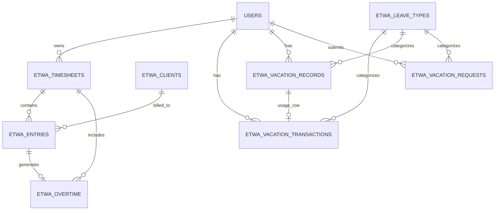

# Database Schema

All tables use the WordPress table prefix (e.g. `wp_etwa_*`).

**Current schema version:** `1.4.1` (stored in option `etwa_db_version`)

## etwa_timesheets

Date-based reporting periods (work week Sun–Thu).

| Column | Type | Description |
|--------|------|-------------|
| id | BIGINT PK | Auto increment |
| user_id | BIGINT | WordPress user ID |
| period_start | DATE | Week start (Sunday) |
| period_end | DATE | Week end (Thursday) |
| status | VARCHAR(20) | draft, submitted, approved, rejected |
| total_regular_hours | DECIMAL(8,2) | Aggregated regular hours |
| total_overtime_hours | DECIMAL(8,2) | Aggregated OT hours |
| submitted_at | DATETIME | Submission timestamp |
| reviewed_by | BIGINT | Reviewer user ID |
| reviewed_at | DATETIME | Review timestamp |
| review_notes | TEXT | HR/Owner notes |
| is_locked | TINYINT(1) | Period lock flag |
| created_at | DATETIME | Created |
| updated_at | DATETIME | Updated |

**Indexes:** UNIQUE(user_id, period_start, period_end), status, period_start

---

## etwa_entries

Individual time entries (date-based, not fixed weekly rows).

| Column | Type | Description |
|--------|------|-------------|
| id | BIGINT PK | Auto increment |
| timesheet_id | BIGINT FK | Parent timesheet |
| user_id | BIGINT | Employee |
| entry_date | DATE | Entry date |
| start_time | TIME | Start (30-min intervals) |
| end_time | TIME | End |
| client_id | BIGINT FK | Client reference |
| task | VARCHAR(255) | Task description |
| notes | TEXT | Optional notes |
| duration_minutes | INT | Total duration |
| regular_hours | DECIMAL(8,2) | Calculated regular |
| overtime_hours | DECIMAL(8,2) | Calculated OT |
| created_at | DATETIME | Created |
| updated_at | DATETIME | Updated |

**Example row:** `2026-07-06 | 17:00–18:00 | SDM | Website`

---

## etwa_clients

| Column | Type | Description |
|--------|------|-------------|
| id | BIGINT PK | Auto increment |
| name | VARCHAR(191) | Client name |
| code | VARCHAR(50) UNIQUE | Short code |
| department | VARCHAR(100) | Department grouping |
| is_active | TINYINT(1) | Active flag |
| created_at | DATETIME | Created |

---

## etwa_overtime

Separate overtime approval workflow.

| Column | Type | Description |
|--------|------|-------------|
| id | BIGINT PK | Auto increment |
| user_id | BIGINT | Employee |
| timesheet_id | BIGINT | Related timesheet |
| entry_id | BIGINT UNIQUE | Source entry |
| entry_date | DATE | OT date |
| overtime_hours | DECIMAL(8,2) | Requested OT |
| status | VARCHAR(20) | pending, approved, rejected |
| approved_hours | DECIMAL(8,2) | Approved OT amount |
| reviewed_by | BIGINT | Reviewer |
| reviewed_at | DATETIME | Review time |
| review_notes | TEXT | Notes |
| created_at | DATETIME | Created |
| updated_at | DATETIME | Updated |

---

## etwa_settings

Key-value configuration store.

| Column | Type | Description |
|--------|------|-------------|
| id | BIGINT PK | Auto increment |
| setting_key | VARCHAR(100) UNIQUE | Setting name |
| setting_value | LONGTEXT | Serialized value |
| autoload | TINYINT(1) | Load on boot |

**Default keys:** work_day_start, work_day_end, time_interval_minutes, min_overtime_minutes, overtime_round_minutes, available_hours_week, hr_email, owner_email, email_cc_owner, autosave_interval

---

## etwa_holidays

Company holidays (used by timesheet/calendar features).

| Column | Type | Description |
|--------|------|-------------|
| id | BIGINT PK | Auto increment |
| name | VARCHAR(191) | Holiday name |
| holiday_date | DATE | Date |
| is_recurring | TINYINT(1) | Repeats yearly |
| created_at | DATETIME | Created |
| updated_at | DATETIME | Updated |

---

## Vacation & leave (schema v1.4+)

### Balance model

Each employee has a **single annual leave pool**:

```
allocated  = SUM(allocation + adjustment) on Annual Leave type
used       = SUM(|usage|) for all types except unpaid
remaining  = allocated − used
```

Implemented in `ETWA\Helpers\VacationHelper::annual_pool()`. Only **Annual Leave** (`slug: annual`) accepts HR allocations (`tracks_allocation = 1`). Other types record usage for reporting only.

### etwa_leave_types

| Column | Type | Description |
|--------|------|-------------|
| id | BIGINT PK | Auto increment |
| slug | VARCHAR(50) UNIQUE | annual, sick, emergency, compensatory, unpaid |
| name | VARCHAR(191) | Display name |
| tracks_allocation | TINYINT(1) | 1 = annual only (v1.4.1+) |
| sort_order | INT | UI order |
| is_active | TINYINT(1) | Active flag |
| created_at | DATETIME | Created |

**Seeded types:** Annual Leave, Sick Leave, Emergency Leave, Compensatory Leave, Unpaid Leave

---

### etwa_vacation_transactions

Ledger for allocations and usage (source of truth for balances).

| Column | Type | Description |
|--------|------|-------------|
| id | BIGINT PK | Auto increment |
| user_id | BIGINT | Employee |
| leave_type_id | BIGINT FK | Leave type |
| transaction_type | VARCHAR(20) | allocation, usage, adjustment |
| days | DECIMAL(8,2) | Positive for allocation; negative for usage |
| record_id | BIGINT | Linked leave record (usage rows) |
| effective_date | DATE | Allocation date or leave start |
| notes | TEXT | Optional |
| created_by | BIGINT | Actor user ID |
| created_at | DATETIME | Created |

**Indexes:** user_id, leave_type_id, transaction_type, effective_date, record_id, (user_id, leave_type_id, effective_date)

---

### etwa_vacation_records

Approved, pending, or rejected leave periods (HR-created or from approved requests).

| Column | Type | Description |
|--------|------|-------------|
| id | BIGINT PK | Auto increment |
| user_id | BIGINT | Employee |
| leave_type_id | BIGINT FK | Leave type |
| start_date | DATE | First day |
| end_date | DATE | Last day |
| days | DECIMAL(8,2) | Duration |
| reason | TEXT | Employee/HR reason |
| status | VARCHAR(20) | pending, approved, rejected |
| notes | TEXT | Internal notes |
| created_by | BIGINT | Creator |
| updated_by | BIGINT | Last editor |
| created_at | DATETIME | Created |
| updated_at | DATETIME | Updated |

Approved records sync a matching **usage** row in `etwa_vacation_transactions`.

---

### etwa_vacation_requests

Employee-submitted requests awaiting HR review.

| Column | Type | Description |
|--------|------|-------------|
| id | BIGINT PK | Auto increment |
| user_id | BIGINT | Employee |
| leave_type_id | BIGINT FK | Requested type |
| start_date | DATE | First day |
| end_date | DATE | Last day |
| days | DECIMAL(8,2) | Duration |
| reason | TEXT | Required on submit |
| status | VARCHAR(20) | pending, approved, rejected |
| notes | TEXT | HR review notes |
| reviewed_by | BIGINT | Reviewer |
| reviewed_at | DATETIME | Review time |
| created_at | DATETIME | Created |
| updated_at | DATETIME | Updated |

On approval, a record is created and usage is posted; the request status is updated.

---

### User meta (vacation notifications)

| Meta key | Description |
|----------|-------------|
| `etwa_vacation_notifications` | Array of in-app approval/rejection notices (not a custom table) |

---

## etwa_audit_logs

Immutable audit trail.

| Column | Type | Description |
|--------|------|-------------|
| id | BIGINT PK | Auto increment |
| user_id | BIGINT | Actor |
| action | VARCHAR(50) | create, update, submit, approve, lock_period, allocate, etc. |
| entity_type | VARCHAR(50) | timesheet, entry, overtime, vacation_allocation, vacation_record, vacation_request |
| entity_id | BIGINT | Entity reference |
| old_value | LONGTEXT JSON | Previous state |
| new_value | LONGTEXT JSON | New state |
| ip_address | VARCHAR(45) | Client IP |
| created_at | DATETIME | Timestamp |

---

## Entity Relationships

```
users (WP)
  └── etwa_timesheets (1:N)
        └── etwa_entries (1:N)
              ├── etwa_clients (N:1)
              └── etwa_overtime (1:1)

users (WP, role: etwa_employee)
  ├── etwa_vacation_transactions (1:N)
  ├── etwa_vacation_records (1:N)
  └── etwa_vacation_requests (1:N)
        └── etwa_leave_types (N:1)
```

## User meta (preferences)

Not stored in custom tables; used for portal UX.

| Meta key | Values | Description |
|----------|--------|-------------|
| `etwa_dark_mode` | `0` / `1` | User theme preference for portal (light vs OLED dark). Set via AJAX `etwa_toggle_dark_mode`. |

Vacation in-app notifications may also use user meta (see vacation REST docs).

## ER Diagram


