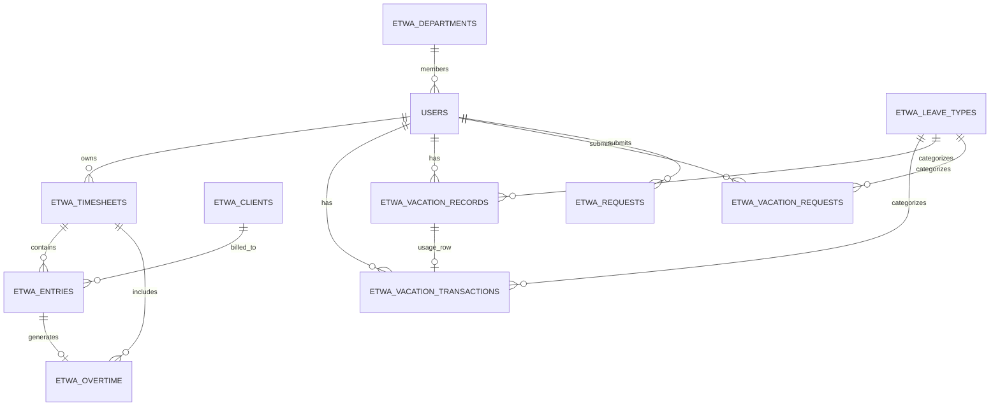

# Database Schema

All tables use the WordPress table prefix (e.g. `wp_etwa_*`).

**Current schema version:** `1.17.0` (stored in option `etwa_db_version`)

## etwa_timesheets

Date-based reporting periods (work week Sun–Thu).

| Column | Type | Description |
|--------|------|-------------|
| id | BIGINT PK | Auto increment |
| user_id | BIGINT | WordPress user ID |
| period_start | DATE | Week start (Sunday) |
| period_end | DATE | Week end (Thursday) |
| status | VARCHAR(20) | draft, submitted, approved, rejected |
| total_regular_hours | DECIMAL(8,2) | Aggregated regular hours |
| total_overtime_hours | DECIMAL(8,2) | Aggregated OT hours |
| submitted_at | DATETIME | Submission timestamp |
| reviewed_by | BIGINT | Reviewer user ID |
| reviewed_at | DATETIME | Review timestamp |
| review_notes | TEXT | HR/Owner notes |
| is_locked | TINYINT(1) | Period lock flag |
| draft_saved_at | DATETIME | When employee last saved a draft snapshot for HR review |
| draft_snapshot | LONGTEXT JSON | Serialized entry snapshot shown to HR before submit (v1.9+) |
| created_at | DATETIME | Created |
| updated_at | DATETIME | Updated |

**Indexes:** UNIQUE(user_id, period_start, period_end), status, period_start

**Draft workflow:** While status is `draft` or `rejected`, HR reviewers see `draft_snapshot` (if saved) instead of live edits. Submit clears the snapshot.

---

## etwa_entries

Individual time entries (date-based, not fixed weekly rows).

| Column | Type | Description |
|--------|------|-------------|
| id | BIGINT PK | Auto increment |
| timesheet_id | BIGINT FK | Parent timesheet |
| user_id | BIGINT | Employee |
| entry_date | DATE | Entry date |
| start_time | TIME | Start (30-min intervals) |
| end_time | TIME | End |
| client_id | BIGINT FK | Client reference |
| task | VARCHAR(255) | Task description |
| notes | TEXT | Optional notes |
| duration_minutes | INT | Total duration |
| regular_hours | DECIMAL(8,2) | Calculated regular |
| overtime_hours | DECIMAL(8,2) | Calculated OT |
| entry_type | VARCHAR(20) | `regular`, `overtime`, or `compensation` (v1.11+) |
| created_from | VARCHAR(100) | Source context (e.g. copy-previous) |
| created_at | DATETIME | Created |
| updated_at | DATETIME | Updated |

**Entry types (after 18:00):**

| Type | Hour columns | Analytics |
|------|--------------|-----------|
| `regular` | `regular_hours` | Regular Hours |
| `overtime` | `overtime_hours` | Overtime Hours |
| `compensation` | `regular_hours` + full duration | Regular + Combined (+ Comp KPI on client detail) |

**Example row:** `2026-07-06 | 17:00–18:00 | SDM | Website | regular`

---

## etwa_clients

| Column | Type | Description |
|--------|------|-------------|
| id | BIGINT PK | Auto increment |
| name | VARCHAR(191) | Client name |
| code | VARCHAR(50) UNIQUE | Short code |
| department | VARCHAR(100) | Department grouping |
| is_active | TINYINT(1) | Active flag |
| created_at | DATETIME | Created |

**System clients:** `Break` (non-billable, excluded from analytics) and **Moderation** (requires detailed notes on each entry; formerly “All Clients”).

---

## etwa_departments

Organizational units with optional department-head approval.

| Column | Type | Description |
|--------|------|-------------|
| id | BIGINT PK | Auto increment |
| name | VARCHAR(191) UNIQUE | Department name |
| description | TEXT | Optional description |
| head_user_id | BIGINT | Assigned department head (WP user) |
| approval_enabled | TINYINT(1) | Dept-head approval for requests |
| status | VARCHAR(20) | `active`, `inactive` |
| created_at | DATETIME | Created |
| updated_at | DATETIME | Updated |

Employee department assignment is stored in user meta (`etwa_department_id`).

---

## etwa_overtime

Separate overtime approval workflow.

| Column | Type | Description |
|--------|------|-------------|
| id | BIGINT PK | Auto increment |
| user_id | BIGINT | Employee |
| timesheet_id | BIGINT | Related timesheet |
| entry_id | BIGINT UNIQUE | Source entry |
| entry_date | DATE | OT date |
| overtime_hours | DECIMAL(8,2) | Requested OT |
| status | VARCHAR(20) | pending, approved, rejected |
| approved_hours | DECIMAL(8,2) | Approved OT amount |
| reviewed_by | BIGINT | Reviewer |
| reviewed_at | DATETIME | Review time |
| review_notes | TEXT | Notes |
| created_at | DATETIME | Created |
| updated_at | DATETIME | Updated |

---

## etwa_settings

Key-value configuration store.

| Column | Type | Description |
|--------|------|-------------|
| id | BIGINT PK | Auto increment |
| setting_key | VARCHAR(100) UNIQUE | Setting name |
| setting_value | LONGTEXT | Serialized value |
| autoload | TINYINT(1) | Load on boot |

**Default keys:** work_day_start, work_day_end, time_interval_minutes, min_overtime_minutes, overtime_round_minutes, available_hours_week, hr_email, owner_email, email_cc_owner, autosave_interval

---

## etwa_email_settings (WordPress option)

Branded HTML email template and signature. Stored in `wp_options` (not a custom table). Managed by `EmailSettingsRepository` (`OPTION_KEY = etwa_email_settings`).

| Key | Description |
|-----|-------------|
| `from_name`, `from_email`, `reply_to` | Outgoing mail headers |
| `logo_id`, `logo_width`, `logo_height` | Signature logo |
| `greeting`, `email_body` | Template wrapper (`email_body` defaults to `{email_content}`) |
| `appreciation`, `closing_text`, `signature_dedication` | Footer text above signature rows |
| `signature_rows` | JSON array of styled signature lines |
| `default_sender_name`, `default_sender_role`, `default_sender_email`, `default_sender_phone` | Fallback sender when no reviewer user ID |
| `company_name`, `company_tagline`, `office_phone`, `office_address` | Company block in signature |

Seeded on plugin activation. See [SYSTEM-DOCUMENTATION.md — Email system](SYSTEM-DOCUMENTATION.md#email-system) for layout and notification details.

---

## etwa_holidays

Company holidays (used by timesheet/calendar features).

| Column | Type | Description |
|--------|------|-------------|
| id | BIGINT PK | Auto increment |
| name | VARCHAR(191) | Holiday name |
| holiday_date | DATE | Date |
| is_recurring | TINYINT(1) | Repeats yearly |
| created_at | DATETIME | Created |
| updated_at | DATETIME | Updated |

---

## Vacation & leave (schema v1.4+)

### Balance model

Each employee has a **single annual leave pool**:

```
allocated  = SUM(allocation + adjustment) on Annual Leave type
used       = SUM(|usage|) for all types except unpaid
remaining  = allocated − used
```

Implemented in `ETWA\Helpers\VacationHelper::annual_pool()`. Only **Annual Leave** (`slug: annual`) accepts HR allocations (`tracks_allocation = 1`). Other types record usage for reporting only.

### etwa_leave_types

| Column | Type | Description |
|--------|------|-------------|
| id | BIGINT PK | Auto increment |
| slug | VARCHAR(50) UNIQUE | annual, sick, emergency, compensatory, unpaid |
| name | VARCHAR(191) | Display name |
| tracks_allocation | TINYINT(1) | 1 = annual only (v1.4.1+) |
| sort_order | INT | UI order |
| is_active | TINYINT(1) | Active flag |
| created_at | DATETIME | Created |

**Seeded types:** Annual Leave, Sick Leave, Emergency Leave, Compensatory Leave, Unpaid Leave

---

### etwa_vacation_transactions

Ledger for allocations and usage (source of truth for balances).

| Column | Type | Description |
|--------|------|-------------|
| id | BIGINT PK | Auto increment |
| user_id | BIGINT | Employee |
| leave_type_id | BIGINT FK | Leave type |
| transaction_type | VARCHAR(20) | allocation, usage, adjustment |
| days | DECIMAL(8,2) | Positive for allocation; negative for usage |
| record_id | BIGINT | Linked leave record (usage rows) |
| effective_date | DATE | Allocation date or leave start |
| notes | TEXT | Optional |
| created_by | BIGINT | Actor user ID |
| created_at | DATETIME | Created |

**Indexes:** user_id, leave_type_id, transaction_type, effective_date, record_id, (user_id, leave_type_id, effective_date)

---

### etwa_vacation_records

Approved, pending, or rejected leave periods (HR-created or from approved requests).

| Column | Type | Description |
|--------|------|-------------|
| id | BIGINT PK | Auto increment |
| user_id | BIGINT | Employee |
| leave_type_id | BIGINT FK | Leave type |
| start_date | DATE | First day |
| end_date | DATE | Last day |
| days | DECIMAL(8,2) | Duration |
| reason | TEXT | Employee/HR reason |
| status | VARCHAR(20) | pending, approved, rejected |
| notes | TEXT | Internal notes |
| created_by | BIGINT | Creator |
| updated_by | BIGINT | Last editor |
| created_at | DATETIME | Created |
| updated_at | DATETIME | Updated |

Approved records sync a matching **usage** row in `etwa_vacation_transactions`.

---

### etwa_vacation_requests

Employee-submitted requests awaiting HR review.

| Column | Type | Description |
|--------|------|-------------|
| id | BIGINT PK | Auto increment |
| user_id | BIGINT | Employee |
| leave_type_id | BIGINT FK | Requested type |
| start_date | DATE | First day |
| end_date | DATE | Last day |
| days | DECIMAL(8,2) | Duration |
| reason | TEXT | Required on submit |
| status | VARCHAR(20) | pending, approved, rejected |
| notes | TEXT | HR review notes |
| reviewed_by | BIGINT | Reviewer |
| reviewed_at | DATETIME | Review time |
| created_at | DATETIME | Created |
| updated_at | DATETIME | Updated |

On approval, a record is created and usage is posted; the request status is updated.

---

## etwa_requests

Unified permission and leave-adjacent request workflow (v1.6+).

| Column | Type | Description |
|--------|------|-------------|
| id | BIGINT PK | Auto increment |
| request_type | VARCHAR(30) | e.g. permission, leave |
| user_id | BIGINT | Employee |
| request_date | DATE | Submission date |
| work_date | DATE | Affected work date |
| start_time / end_time | TIME | Permission window |
| permission_type | VARCHAR(50) | Permission category |
| reason | TEXT | Employee reason |
| notes | TEXT | Review notes |
| status | VARCHAR(20) | pending, approved, rejected |
| reviewed_by / reviewed_at | BIGINT / DATETIME | Legacy single reviewer |
| hr_approved_by / hr_approved_at | BIGINT / DATETIME | HR approval step |
| owner_approved_by / owner_approved_at | BIGINT / DATETIME | Owner approval step |
| dept_approved_by / dept_approved_at | BIGINT / DATETIME | Department-head step |
| workflow_status | VARCHAR(30) | e.g. `pending_hr`, `pending_dept` |
| extra_data | LONGTEXT JSON | Type-specific payload |
| created_at / updated_at | DATETIME | Timestamps |

Dual/hierarchical approval columns added in v1.5.0 (vacation requests) and v1.8.0 (general requests).

---

### User meta (vacation notifications)

| Meta key | Description |
|----------|-------------|
| `etwa_vacation_notifications` | Array of in-app approval/rejection notices (not a custom table) |

---

## etwa_audit_logs

Immutable audit trail.

| Column | Type | Description |
|--------|------|-------------|
| id | BIGINT PK | Auto increment |
| user_id | BIGINT | Actor |
| action | VARCHAR(50) | create, update, submit, approve, lock_period, allocate, etc. |
| entity_type | VARCHAR(50) | timesheet, entry, overtime, vacation_allocation, vacation_record, vacation_request |
| entity_id | BIGINT | Entity reference |
| old_value | LONGTEXT JSON | Previous state |
| new_value | LONGTEXT JSON | New state |
| ip_address | VARCHAR(45) | Client IP |
| created_at | DATETIME | Timestamp |

---

## Entity Relationships

```
users (WP)
  └── etwa_timesheets (1:N)
        └── etwa_entries (1:N)
              ├── etwa_clients (N:1)
              └── etwa_overtime (1:1)

users (WP, role: etwa_employee)
  ├── etwa_departments (N:1 via user meta)
  ├── etwa_requests (1:N)
  ├── etwa_vacation_transactions (1:N)
  ├── etwa_vacation_records (1:N)
  └── etwa_vacation_requests (1:N)
        └── etwa_leave_types (N:1)

etwa_departments
  └── head_user_id → users (department head)
```

## User meta (profiles & preferences)

Not stored in custom tables; used for portal UX and employee profiles.

| Meta key | Description |
|----------|-------------|
| `etwa_dark_mode` | `0` / `1` — light vs OLED dark theme (`etwa_toggle_dark_mode` AJAX) |
| `etwa_job_title` | Job title |
| `etwa_join_date` | Join date (Y-m-d) |
| `etwa_birthday` | Birthday (Y-m-d) |
| `etwa_phone` | Phone number |
| `etwa_department_id` | Assigned department ID |
| `etwa_hourly_cost_egp` | Hourly labor cost (EGP) for analytics/reports |
| `etwa_employment_status` | `active` / `inactive` |
| `etwa_vacation_notifications` | In-app vacation approval/rejection notices |

## ER Diagram



## Schema migration history (selected)

| Version | Notable change |
|---------|----------------|
| 1.4.1 | Annual leave pool (`tracks_allocation` on leave types) |
| 1.6.0 | `etwa_requests` table |
| 1.7.0 | Entry time-offset migration; system clients |
| 1.9.0 | Timesheet draft snapshot columns |
| 1.11.0 | `entry_type` column; Moderation client rename |
| 1.12.0 | Overtime cost multiplier default → 1× |
| 1.13.0–1.17.0 | Entry type flow, after-hours reclassification, hour normalization, compensation fixes |
